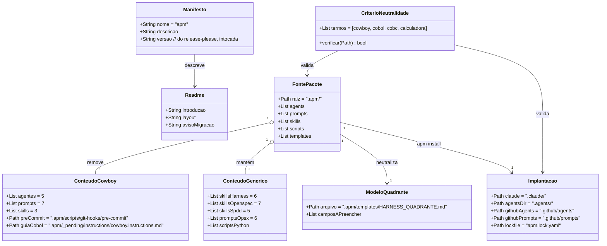

# Limpeza do cowboy no pacote APM

## Requirements

Remover do pacote APM `emilianoeloi/apm` tudo o que é exclusivo do projeto cowboy (COBOL), neutralizar o que fica e reimplantar o pacote, de modo que a fonte `.apm/` e a implantação local passem na busca vazia por "cowboy", "cobol", "cobc" e "calculadora", sem tocar nas skills, hooks e scripts genéricos do harness, de OpenSpec e de OpenSPDD.

## Entities

Nenhuma estrutura nova é criada: só arquivos existentes são apagados ou editados. O `CriterioNeutralidade` é uma busca de linha de comando, não código.

## Approach

1. Remoção:
   - Apagar da fonte, sem mover para outro lugar, os 5 agentes, os 7 prompts, as 3 skills, o pre-commit e o guia de instruções COBOL (Decisão 1 da spec).
   - O pre-commit sai junto porque depende de `tests/fitness` e `cobc`; o substituto genérico é da F2.
2. Neutralização:
   - `openspec-workflow`: trocar os exemplos COBOL por texto sem stack.
   - `HARNESS_QUADRANTE.md`: virar cópia do modelo neutro de `harness-quadrant-process/references/quadrant-doc-template.md`.
   - `apm.yml` e `README.md`: sem "privado" e sem "extraído do cowboy"; nome `apm`; aviso de migração da 0.3.x.
3. Implantação:
   - Reimplantar com `apm install --target claude,copilot` e conferir órfãos; usar `apm prune` se preciso.
   - Ignorar `.harness/` no git.
4. Prova:
   - A busca pelos quatro termos em `.apm/` e nos diretórios implantados deve voltar vazia.
   - Os comandos do gate (`session-start.py`, `openspec list`, `phase_cli.py show`) e o `openspec validate --strict` continuam passando.
5. Release:
   - Título do PR `feat!: …` (incompatível); o PR de release do release-please não é mesclado antes da change de pré-lançamento.

## Structure

### Inheritance Relationships
1. `HARNESS_QUADRANTE.md` passa a ter o mesmo conteúdo de `quadrant-doc-template.md`; a skill continua dona do modelo e o arquivo de `templates/` é a cópia entregue.

### Dependencies
1. `apm install` lê `.apm/` e escreve `.claude/`, `.agents/`, `.github/agents`, `.github/prompts` e `apm.lock.yaml`.
2. O `apm.lock.yaml` lista cada arquivo implantado; a reimplantação depende de a fonte já estar limpa.
3. O `README.md` descreve o layout de `.apm/` e depende de a fonte já refletir o resultado.
4. O release-please lê as mensagens de commit; a versão do `apm.yml` e o manifesto não são editados à mão.

### Layered Architecture
1. Fonte (`.apm/`): conteúdo versionado e autoral.
2. Manifesto e documentação (`apm.yml`, `README.md`): identidade pública.
3. Implantação (`.claude/`, `.agents/`, `.github/`, `apm.lock.yaml`): derivada, gerada pelo APM.
4. Gate de fase (`harness.config.json`, `scripts/hooks`, `scripts/harness`): não muda.

## Operations

### Remove Content - Agentes do cowboy
1. Responsibility: tirar os 5 agentes da fonte.
2. Paths: `.apm/agents/cobol-vibecoder.agent.md`, `cobol-planner.agent.md`, `cobol-coder.agent.md`, `cobol-reviewer.agent.md`, `readme-writer.agent.md`.
3. Logic: apagar com `git rm`; a pasta `.apm/agents/` pode ficar vazia (mantida com `.gitkeep` para a F3).
4. Verification: `ls .apm/agents` não lista `cobol-*` nem `readme-writer`.

### Remove Content - Prompts do cowboy
1. Responsibility: tirar os 7 prompts do cowboy.
2. Paths: `.apm/prompts/{criar-programa,implementar-soma,implementar-subtracao,implementar-log,testar-programa,atualizar-readme,manutencao-repositorio}.prompt.md`.
3. Verification: `ls .apm/prompts` lista só os 6 `opsx-*.prompt.md`.

### Remove Content - Skills do cowboy
1. Responsibility: tirar as 3 skills.
2. Paths: `.apm/skills/cobol-calculadora/`, `.apm/skills/vibe-coding-fundamentals/`, `.apm/skills/readme-manutencao/`.
3. Verification: `ls .apm/skills` não as lista.

### Remove Content - Scripts e guia pendente
1. Responsibility: tirar o pre-commit COBOL e o guia de instruções COBOL.
2. Paths: `.apm/scripts/git-hooks/` e `.apm/_pending/instructions/cowboy.instructions.md` (e a pasta `instructions/` se ficar vazia).
3. Verification: os caminhos não existem; `.apm/_pending/hooks/harness.json` permanece.

### Update Skill - openspec-workflow
1. Responsibility: exemplos sem stack.
2. Logic:
   - Linha 69: trocar o exemplo de decisões técnicas por "ex.: estruturas de dados, interfaces, tratamento de erro".
   - Linha 76: `## 4. Fase 4 - Generate (Implementação)`.
   - Linhas 95 a 97: `- [x] 4.1 Implementar a Operation do canvas`, `- [x] 4.2 Rodar o build do projeto`, `- [x] 4.3 Passar nos sensores do projeto (comando em harness.config.json)`.
3. Verification: `grep -niE "cobol|cobc|calculadora|make fitness" .apm/skills/openspec-workflow/SKILL.md` vazio.

### Replace Template - HARNESS_QUADRANTE.md
1. Responsibility: virar modelo.
2. Logic: sobrescrever `.apm/templates/HARNESS_QUADRANTE.md` com o conteúdo de `.apm/skills/harness-quadrant-process/references/quadrant-doc-template.md`.
3. Verification: o arquivo tem campos `<...>` e nenhum dos quatro termos.

### Update Manifest - apm.yml
1. Responsibility: identidade genérica.
2. Logic: `name: apm`; `description:` "Pacote APM genérico com Lean Inception, Harness e SDLC, em skills, agentes e hooks, para qualquer stack."; não alterar `version`, `author`, `license`, `type`, `targets`, `includes` nem `dependencies`.
3. Verification: `apm install --dry-run --target claude,copilot` sem erro; `grep -i cowboy apm.yml` vazio.

### Update Doc - README.md
1. Responsibility: introdução pública, layout correto, aviso de migração.
2. Logic:
   - Introdução: pacote APM público, genérico, para qualquer stack.
   - Consumo: exemplo com a tag mais recente publicada (`v0.3.1`).
   - Layout: sem `.apm/hooks/*.json` e sem `pre-commit`.
   - Seção "Migração da 0.3.x": lista dos agentes, prompts, skills, hook e pre-commit removidos e a indicação da tag `v0.3.1` para o estado antigo.
   - Manter a nota pendente sobre a entrega de scripts de hook (segue pendente até a F2).
3. Verification: o texto cobre os cenários "Visibilidade" e "Leitor da 0.3.x" da spec.

### Update Config - .gitignore
1. Responsibility: não versionar o estado de fase.
2. Logic: acrescentar a linha `.harness/` ao `.gitignore`.
3. Verification: `git check-ignore -v .harness/change-phase.json` aponta a regra.

### Redeploy - apm install
1. Responsibility: alinhar a implantação à fonte.
2. Logic: `apm install --target claude,copilot`; se sobrar órfão, `apm prune`; se ainda sobrar, apagar só arquivos listados no `apm.lock.yaml`.
3. Verification: busca pelos quatro termos em `.claude/`, `.agents/`, `.github/agents`, `.github/prompts` vazia; `grep -iE "cobol|cowboy|readme-writer" apm.lock.yaml` vazio.

### Verify - Integração
1. Responsibility: provar a neutralidade e que o gate segue funcionando.
2. Logic: `grep -rniE "cowboy|cobol|cobc|calculadora" .apm`; `echo '{"source":"new"}' | python3 scripts/hooks/session-start.py`; `openspec list`; `python3 scripts/harness/phase_cli.py show`; `openspec validate limpeza-do-cowboy --strict`.
3. Output: resultado registrado na seção da Onda 1 do `CHANGELOG.md`, com a remoção marcada como incompatível.

## Norms

1. Commits e título do PR em Conventional Commits; remoção incompatível com `!` (`feat!:`).
2. Mensagens, textos e comentários em português; termos estruturais do OpenSpec e SHALL/MUST em inglês.
3. Remoções com `git rm`, para o histórico mostrar o arquivo apagado.
4. Nenhum arquivo vendorizado (`openspec-*`, `opsx-*`, `spdd-*`) é editado à mão.
5. A versão no `apm.yml` e o manifesto do release-please são do bot; não editar.
6. Cada task só vira `[x]` depois de o comando de verificação dela passar.
7. Ferramentas e comandos citados em textos do pacote não podem ser de uma stack específica.

## Safeguards

1. Functional Constraints: ao fim, a busca pelos quatro termos em `.apm/` e nos diretórios implantados volta vazia; os 6 `opsx-*`, os 5 `spdd-*`, os 7 `openspec-*` e as skills de harness continuam presentes e sem mudança de conteúdo.
2. Integration Constraints: `scripts/hooks/*.py`, `scripts/harness/phase_cli.py`, `harness.config.json` e `.claude/settings.json` não são alterados.
3. Security Constraints: nenhum segredo é lido ou escrito; os hooks continuam bloqueando `git push`, `reset --hard`, `clean -f`, `branch -D` e `rm -rf`.
4. Release Constraints: sem push, sem tag e sem merge do PR de release sem o "ok" do Elói; o PR de release só é mesclado depois da change de pré-lançamento.
5. Scope Constraints: nada de hook genérico, pre-commit genérico, agentes `sdlc-*` ou mudança de release-please nesta change.
6. Data Constraints: o aviso de migração lista exatamente os itens removidos (5 agentes, 7 prompts, 3 skills, 1 hook, 1 pre-commit); o diagnóstico da spec é a referência.
7. Reversibility Constraints: tudo é desfeito por `git revert` do PR; a tag `v0.3.1` permanece intocada.
