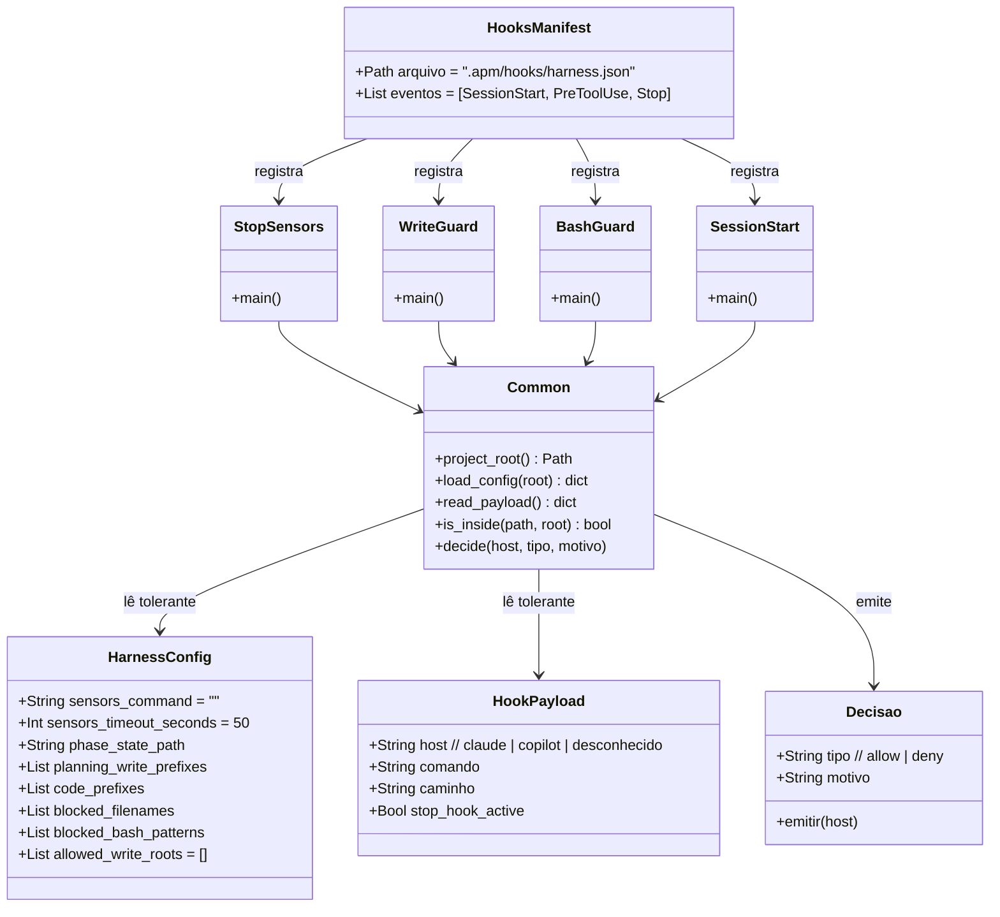

# Hooks genéricos com sensores configuráveis

## Requirements

Entregar, pelo próprio APM, hooks que funcionem em qualquer stack e em qualquer host: um hook de encerramento que roda o comando de sensores definido pelo projeto (e nunca bloqueia sem ele) e guardas de segurança que não travam com entrada inválida, impedem escrita fora do repositório de verdade e bloqueiam no formato que cada host entende, tudo coberto por testes que o próprio repositório usa como sensor.

## Entities

Conservador: os três scripts existentes mantêm nome, entradas e regras; só mudam o que as correções exigem. O `phase_cli.py` não ganha helper.

## Approach

1. Entrega:
   - Scripts e `_common.py` em `.apm/hooks/scripts/`; registro achatado em `.apm/hooks/harness.json` com `${PLUGIN_ROOT}`.
   - `apm install` registra em `.claude/settings.json` e `.github/hooks/` e implanta o bundle (confirmado em teste descartável).
   - Remove-se a cópia manual (`scripts/hooks/`, `.claude/settings.json` e o registro em `_pending`).
2. Tolerância:
   - `read_payload` e `load_config` nunca levantam exceção: devolvem `{}`.
   - Valores de tipo errado viram o padrão; entradas de padrão sem `pattern` ou com regex inválida são ignoradas.
   - Os bloqueios embutidos não dependem da configuração.
3. Decisão por host:
   - O host vem do formato do payload.
   - Claude: código 2 e motivo em stderr. Copilot: JSON `permissionDecision` em stdout e código 0.
   - Payload irreconhecível: permite.
4. Sensores no encerramento:
   - `stop-sensors.py` lê `sensors_command` e `sensors_timeout_seconds`.
   - `stop_hook_active` libera; comando vazio libera; código 0 libera.
   - Código diferente de 0 ou estouro de tempo bloqueiam com código 2 e o final da saída.
5. Contenção de caminho:
   - Comparar com `Path.relative_to` em vez de `startswith` de texto, nos guardas e no `phase_cli.py`.
   - Fora da raiz só passa por `allowed_write_roots` (opt-in, absolutos, nunca credencial).
6. Prova:
   - Testes de subprocesso em `tests/hooks/` e um teste num projeto temporário que instala o pacote.
   - O `harness.config.json` do repositório usa esses testes como `sensors_command`.

## Structure

### Inheritance Relationships
1. Nenhuma herança. `Common` é um módulo de funções importado pelos quatro scripts.

### Dependencies
1. `stop-sensors.py`, `pre-tool-write-guard.py`, `pre-tool-bash-guard.py` e `session-start.py` importam `_common.py` do mesmo diretório.
2. `.apm/hooks/harness.json` referencia os quatro scripts por `${PLUGIN_ROOT}/.apm/hooks/scripts/<nome>.py`.
3. `tests/hooks/*` chamam os scripts por `subprocess`, com `CLAUDE_PROJECT_DIR` apontando para uma pasta temporária.
4. `phase_cli.py` não depende do helper; só ganha as correções de contenção e de estado corrompido.
5. O skill `install-dev-harness` depende de os hooks chegarem pelo APM.

### Layered Architecture
1. Registro: `.apm/hooks/harness.json` (o que dispara e quando).
2. Scripts de hook: decisão por evento.
3. Helper: leitura tolerante, contenção, emissão por host.
4. Configuração do projeto: `harness.config.json`.
5. Testes: `tests/hooks/`.

## Operations

### Move Files - Scripts de hook
1. Responsibility: levar os três scripts ao diretório entregue pelo APM.
2. Paths: `.apm/scripts/hooks/{session-start,pre-tool-write-guard,pre-tool-bash-guard}.py` para `.apm/hooks/scripts/`, com `git mv`.
3. Verification: `.apm/scripts/hooks/` não existe; os três arquivos existem no destino.

### Create Module - _common.py
1. Responsibility: reunir o que os scripts repetem.
2. Functions:
   - `project_root() -> Path`: `CLAUDE_PROJECT_DIR` se definido, senão sobe do diretório atual até achar `.git`, senão o diretório atual.
   - `load_config(root) -> dict`: abre `HARNESS_CONFIG_PATH` ou `root/harness.config.json`; devolve `{}` se faltar, não for JSON ou não for objeto.
   - `read_payload() -> dict`: lê a entrada padrão; devolve `{}` se vazia, inválida ou não for objeto.
   - `cfg_list(config, key, default) -> list`, `cfg_str(config, key, default) -> str`, `cfg_int(config, key, default) -> int`: devolvem o padrão quando o tipo não confere.
   - `is_inside(path, root) -> bool`: `True` só se `path.resolve()` estiver dentro de `root.resolve()` como diretório (sem prefixo de texto).
   - `host_of(payload) -> str`: `"claude"` se houver `tool_name`, `"copilot"` se houver `toolName`, senão `"desconhecido"`.
   - `allow()` e `deny(payload, reason)`: Claude: escreve o motivo em stderr e sai com 2; Copilot: imprime `{"permissionDecision": "deny", "permissionDecisionReason": reason}` e sai com 0; desconhecido: permite.
3. Constraints: só biblioteca padrão; nenhuma função levanta exceção por entrada inválida.

### Update Hook - pre-tool-write-guard.py
1. Responsibility: bloquear credenciais, escrita fora da raiz e escrita de código em `proposal`.
2. Logic: usar as funções de `_common`; nomes e sufixos bloqueados com padrão embutido quando a configuração não os dá; contenção por `is_inside`; caminho fora da raiz mas dentro de `allowed_write_roots` (absolutos, depois de expandir `~` e variáveis) é permitido sem passar pela fase; fase `proposal` como hoje; qualquer erro interno permite.
3. Verification: `tests/hooks/test_guards.py`.

### Update Hook - pre-tool-bash-guard.py
1. Responsibility: bloquear comandos destrutivos e, em `proposal`, os que mutam o repositório.
2. Logic: padrões da configuração ou os embutidos (com `git branch -D`, só o `D` maiúsculo, via `(?-i:D)`); os padrões de `git` e `rm` ancorados na posição de comando (`_CMD`: início, `;`, `&`, `|`, quebra de linha ou `$(`, com `(` e `sudo` opcionais; crase fica de fora), para que a menção em texto não bloqueie; ignorar entradas sem `pattern` ou com regex inválida; decisão por host.
3. Verification: `tests/hooks/test_guards.py`.

### Update Hook - session-start.py
1. Responsibility: injetar o contexto do harness.
2. Logic: usar `_common`; `guide_files` malformado vira o padrão; nunca levantar exceção; imprimir `{"additionalContext": ...}`.
3. Verification: `tests/hooks/test_guards.py` (saída JSON com `additionalContext`, também sem configuração).

### Create Hook - stop-sensors.py
1. Responsibility: decidir o encerramento pelos sensores do projeto.
2. Logic:
   - Ler o payload; se `stop_hook_active` for verdadeiro, sair com 0.
   - Ler `sensors_command` (texto) e `sensors_timeout_seconds` (inteiro entre 1 e 3600, padrão 50); se o comando for vazio, sair com 0.
   - Rodar com `subprocess.Popen(comando, shell=True, cwd=root, start_new_session=True, ...)` e `communicate(timeout=...)`; no estouro, matar o grupo de processos (`os.killpg`) para não deixar sensor órfão.
   - Código 0: sair com 0. Código diferente de 0: escrever em stderr "Sensores falharam (código N); corrija antes de encerrar." mais os últimos 3000 caracteres da saída e sair com 2. `TimeoutExpired`: escrever o estouro e sair com 2. `OSError` ao iniciar: avisar em stderr e sair com 0.
3. Verification: `tests/hooks/test_stop_sensors.py`.

### Create Manifest - .apm/hooks/harness.json
1. Responsibility: registrar os hooks para o APM.
2. Content: formato achatado; `SessionStart` (`session-start.py`, 5 s), `PreToolUse` com matcher `Write|Edit|NotebookEdit` (`pre-tool-write-guard.py`, 5 s) e matcher `Bash` (`pre-tool-bash-guard.py`, 5 s), `Stop` (`stop-sensors.py`, 60 s); comandos `python3 "${PLUGIN_ROOT}/.apm/hooks/scripts/<nome>.py"`.
3. Verification: `python3 -m json.tool`; depois `apm install` registra os três eventos.

### Update Templates - harness.config.json
1. Responsibility: documentar os campos novos.
2. Logic: acrescentar `"sensors_command": ""`, `"sensors_timeout_seconds": 50` e `"allowed_write_roots": []`, com comentários, aos dois modelos; alinhar `blocked_bash_patterns` aos padrões embutidos; tirar `.pre-commit-config.yaml` do `guide_files` do modelo do skill.

### Fix CLI - phase_cli.py
1. Responsibility: contenção exata e leitura tolerante.
2. Logic: `_state_path` usa `Path.relative_to` em vez de `startswith`; `show` trata estado corrompido ou sem objeto imprimindo "Fase: estado inválido" com código 0.
3. Verification: `tests/hooks/test_phase_cli.py`.

### Create Script - pre-commit genérico
1. Responsibility: rodar os sensores antes do commit.
2. Logic: `.apm/scripts/git-hooks/pre-commit` em `sh`: lê `sensors_command` da configuração com `python3 -c`; vazio passa com `exit 0`; senão executa e propaga o código de saída com a saída na tela.
3. Verification: repositório temporário, com e sem `sensors_command`.

### Update Skill - install-dev-harness
1. Responsibility: parar de copiar hooks.
2. Logic: remover a cópia de `scripts/hooks/*` e a mesclagem de `settings.hooks.json` dos passos 3 e 6; acrescentar `apm approve` e o pre-commit opcional; apagar `templates/hooks/` e `templates/settings.hooks.json`.
3. Verification: `grep -n "scripts/hooks\|settings.hooks"` no `SKILL.md` volta vazio.

### Create Tests - tests/hooks
1. Responsibility: provar os cenários das duas specs.
2. Files: `test_stop_sensors.py`, `test_guards.py`, `test_phase_cli.py` (`unittest`, `subprocess`, pastas temporárias).
3. Verification: `python3 -m unittest discover -s tests -t . -v` passa.

### Dogfood - harness.config.json e CLAUDE.md
1. Responsibility: o repositório usa o próprio sensor.
2. Logic: `sensors_command` = `python3 -m unittest discover -s tests -t . -v`; `CLAUDE.md` descreve esse quality gate no lugar de "não informado".
3. Verification: `echo '{}' | python3 .apm/hooks/scripts/stop-sensors.py` sai com 0.

### Reinstall - entrega e prova
1. Responsibility: confirmar a entrega pelo APM.
2. Logic: apagar `scripts/hooks/` e `.claude/settings.json` do repositório; `apm install --target claude,copilot`; conferir os eventos uma vez cada; num projeto temporário, instalar e rodar os scripts implantados; tentar o bloqueio no Claude Code real e registrar o resultado.

## Norms

1. Python 3 só com biblioteca padrão; nada de dependência a instalar.
2. Nenhum script cita linguagem, pasta ou comando de projeto; o que é do projeto vem da configuração.
3. Fail-open para configuração e payload; fail-closed só para as defesas embutidas.
4. Mensagens em português; termos estruturais do OpenSpec e SHALL/MUST em inglês.
5. Testes de comportamento por `subprocess`, sem mocks de sistema de arquivos; cada teste usa uma pasta temporária própria.
6. Commits em Conventional Commits (`feat:`); movimentações com `git mv`.
7. Cada task só vira `[x]` depois de o comando de verificação passar.

## Safeguards

0. Alinhamento: os padrões de `blocked_bash_patterns` dos dois modelos e do `harness.config.json` do repositório são iguais aos embutidos do guarda (teste de deriva).
1. Functional Constraints: Stop sem configuração sai com 0; com sensor que falha sai com 2 e stderr traz a saída; `stop_hook_active` verdadeiro nunca roda o comando.
2. Security Constraints: `git push`, `reset --hard`, `clean -f`, `branch -D`, `rm -rf` e escrita em credenciais bloqueiam mesmo sem configuração; escrita em pasta irmã de nome parecido é bloqueada; nenhuma credencial é lida ou escrita.
3. Compatibility Constraints: os nomes dos três scripts, o formato de payload do Claude e do Copilot e as chaves existentes do `harness.config.json` não mudam; chaves desconhecidas são ignoradas.
4. Reliability Constraints: nenhuma entrada inválida produz traceback; limite de tempo do sensor menor que o `timeout` do registro.
5. Delivery Constraints: cada evento aparece uma vez em `.claude/settings.json`; os scripts referenciados existem nos caminhos registrados.
6. Verification Constraints: o formato do Copilot e o disparo no Claude Code real que não puderem ser provados aqui ficam declarados como "não verificado".
7. Release Constraints: sem push, sem tag e sem merge do PR de release sem o "ok" do Elói; PR com título `feat:` (sem `!`).
8. Scope Constraints: nada dos agentes `sdlc-*`, do pré-lançamento ou do sensor anti-fantasma.
