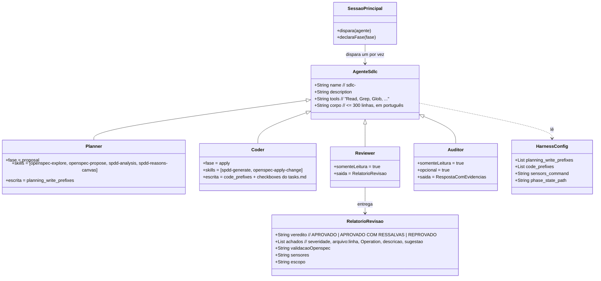

# Agentes de SDLC genéricos do pacote APM

## Requirements

Entregar, pelo APM e a partir de um arquivo por papel, quatro agentes de SDLC que carregam no Claude Code e no GitHub Copilot, não citam stack nenhuma e dividem o fluxo em planejar, implementar, revisar e auditar com escopo de escrita exclusivo, deixando para a sessão principal disparar cada um e para o humano decidir o merge, com o contrato dos agentes coberto por testes.

## Entities

Conservador: nenhum código de produção novo, só arquivos de agente e testes. Os skills, os hooks e o `phase_cli.py` não mudam.

## Approach

1. Formato único:
   - Um arquivo `.apm/agents/sdlc-<papel>.agent.md` por papel; frontmatter com `name`, `description` e `tools`.
   - `tools` em texto separado por vírgula com nomes do Claude, que o Copilot aceita como alias.
   - Sem `model`, `handoffs`, `skills:` nem `color`.
2. Escopo por papel:
   - Planner: gate de fase existente; declara `proposal` só se não houver fase ou for `done`; para se for `apply`.
   - Coder: exige fase `apply` e canvas; escreve em `code_prefixes` e nos checkboxes do `tasks.md`; roda os sensores antes de entregar.
   - Reviewer e auditor: sem `Write` e `Edit`; texto proíbe comandos que alteram arquivos; conferem `git status --porcelain` no fim.
3. Contexto do projeto:
   - Todo agente lê primeiro o arquivo raiz do agente e o `harness.config.json`.
   - O que faltar vira "não informado", nunca suposição.
4. Saída:
   - Reviewer: relatório na mensagem final, com veredito e achados rastreados a arquivo, linha e Operation.
   - Auditor: resposta com evidências.
5. Prova:
   - Testes de contrato estáticos em `tests/agents/`.
   - Reimplantação, `claude plugin validate .claude/agents` e teste de fumaça de somente leitura.
   - A prova do fluxo completo é a calculadora em Go.

## Structure

### Inheritance Relationships
1. Não há herança de código; os quatro agentes seguem o mesmo gabarito de corpo: Papel e escopo, Antes de começar, O que faz, O que não faz, Escrita permitida, Entregável.

### Dependencies
1. Cada agente depende do `harness.config.json` e do arquivo raiz do projeto, lidos em tempo de execução.
2. Planner depende dos skills `openspec-explore`, `openspec-propose`, `spdd-analysis` e `spdd-reasons-canvas`; coder, de `spdd-generate` e `openspec-apply-change`; reviewer e auditor, do CLI `openspec` e do comando de sensores do projeto.
3. O planner depende do gate de fase (hooks da F2) e do `phase_cli.py`.
4. `tests/agents/test_contract.py` depende de `.apm/agents/`, `.apm/skills/` e, para a implantação, de `.claude/agents/` e `.github/agents/`.

### Layered Architecture
1. Fonte: `.apm/agents/sdlc-*.agent.md`.
2. Implantação: `.claude/agents/` e `.github/agents/` (geradas pelo `apm install`).
3. Contexto do projeto: arquivo raiz do agente e `harness.config.json`.
4. Enforcement: gate de fase e hooks (planner); conferência de diff pelo reviewer (coder).
5. Testes: `tests/agents/`.

## Operations

### Create Agent - sdlc-planner.agent.md
1. Responsibility: planejar sem tocar em código.
2. Frontmatter: `name: sdlc-planner`; `description` (usar para planejar uma funcionalidade: proposta OpenSpec, análise e REASONS Canvas, antes de qualquer código; disparado pela sessão principal); `tools: Read, Grep, Glob, Write, Edit, Bash, Skill`.
3. Body:
   - Papel e escopo em duas frases; a sessão principal o dispara e ele devolve o resultado a ela.
   - Antes de começar: ler o arquivo raiz (`CLAUDE.md` ou `AGENTS.md`) e o `harness.config.json` (`planning_write_prefixes`, `phase_state_path`); rodar `python3 scripts/harness/phase_cli.py show`; se a fase for `apply`, avisar e parar; se não houver fase ou for `done`, declarar `proposal` com o nome da change; se faltar o `phase_cli.py`, avisar e parar.
   - O que faz, nesta ordem: investigar com `openspec-explore` quando o pedido for vago; criar a proposta com `openspec-propose`; validar com `openspec validate <change> --strict`; produzir a análise com `spdd-analysis` e o canvas com `spdd-reasons-canvas`; devolver os caminhos e as perguntas em aberto.
   - O que não faz: escrever código, testes ou configuração; mudar a fase para `apply`; disparar outro agente; publicar ou dar push.
   - Escrita permitida: só as pastas de `planning_write_prefixes` (por padrão `openspec/` e `spdd/`).
   - Skills citados com o caminho do `SKILL.md` como alternativa se a ferramenta `Skill` não estiver disponível.
4. Constraints: sem nome de linguagem, ferramenta de build ou pasta de projeto; no máximo 300 linhas.

### Create Agent - sdlc-coder.agent.md
1. Responsibility: implementar pelo canvas.
2. Frontmatter: `name: sdlc-coder`; `description` (usar só com canvas aprovado e fase `apply`; gera o código pelas Operations do canvas e roda os sensores); `tools: Read, Grep, Glob, Write, Edit, Bash, Skill`.
3. Body:
   - Antes de começar: ler o arquivo raiz e o `harness.config.json` (`code_prefixes`, `sensors_command`); `phase_cli.py show` deve mostrar `apply`, senão avisar e parar; localizar o canvas aprovado da change, e se não houver, avisar e parar sem escrever nada.
   - O que faz: executar as Operations na ordem com `spdd-generate`; marcar as tasks com `openspec-apply-change`; rodar o `sensors_command` antes de entregar e corrigir até passar; relatar o que gerou, as tasks marcadas e o resultado dos sensores.
   - O que não faz: mudar a fase; escrever fora de `code_prefixes` (exceto os checkboxes do `tasks.md`); alterar o canvas, a proposta ou os hooks; dar push; disparar outro agente.
   - Sem `sensors_command`: dizer "sensores não configurados" e não afirmar que passaram.
4. Constraints: sem termos de stack; no máximo 300 linhas.

### Create Agent - sdlc-reviewer.agent.md
1. Responsibility: revisar para o humano decidir.
2. Frontmatter: `name: sdlc-reviewer`; `description` (usar depois da implementação para revisar o código contra o canvas e as tasks, sem alterar arquivos); `tools: Read, Grep, Glob, Bash`.
3. Body:
   - Antes de começar: ler o arquivo raiz e o `harness.config.json`; registrar `git status --porcelain` inicial.
   - O que faz: conferir cada Operation do canvas contra o código e cada task do `tasks.md`; rodar `openspec validate <change> --strict` e o `sensors_command`; comparar `git diff --name-only` com `code_prefixes` e o `tasks.md` e registrar achado de escopo para o que sobrar; entregar o relatório na mensagem final.
   - Relatório: Veredito (`APROVADO`, `APROVADO COM RESSALVAS` ou `REPROVADO`), Validação OpenSpec, Sensores, Tasks (feitas/total), Escopo, Achados em tabela (severidade, arquivo:linha, Operation, descrição, sugestão) e Estado da árvore.
   - O que não faz: alterar, criar ou apagar arquivos; rodar comandos que alterem arquivos ou o git; corrigir o código; dar push; disparar outro agente.
   - No fim: conferir que `git status --porcelain` é igual ao inicial e dizer isso no relatório.
4. Constraints: sem `Write` e `Edit` em `tools`; sem termos de stack.

### Create Agent - sdlc-auditor.agent.md
1. Responsibility: auditar sob demanda.
2. Frontmatter: `name: sdlc-auditor`; `description` (opcional; usar para tirar dúvidas e auditar conformidade, arquitetura e segurança com evidências do repositório, sem alterar arquivos); `tools: Read, Grep, Glob, Bash`.
3. Body:
   - Antes de começar: ler o arquivo raiz e o `harness.config.json`; registrar `git status --porcelain`.
   - O que faz: responder a dúvida ou auditar o escopo pedido; toda afirmação cita arquivo e linha (ou o comando e a saída); separar fato de inferência; dizer "não informado" quando a evidência não existir.
   - O que não faz: alterar arquivos, corrigir, dar push, disparar outro agente.
   - No fim: conferir que o estado do git não mudou.
4. Constraints: sem `Write` e `Edit`; sem termos de stack.

### Create Tests - tests/agents/test_contract.py
1. Responsibility: provar o contrato sem rodar um modelo.
2. Cases:
   - Exatamente os quatro arquivos `sdlc-*.agent.md` em `.apm/agents/`.
   - Frontmatter parseável por um leitor simples (chaves `name`, `description`, `tools`); `name` igual ao arquivo; `description` não vazia.
   - `tools` só com `Read`, `Grep`, `Glob`, `Write`, `Edit`, `Bash`, `Skill`; ferramentas exatas por papel; reviewer e auditor sem `Write` e `Edit`; nenhum com `Agent` ou `Task`.
   - Sem `model`, `handoffs`, `skills` e `color` no frontmatter.
   - Neutralidade: nenhum termo do cowboy, de linguagens e de ferramentas de build, nem `Makefile`, `src/`.
   - Todo skill citado em backticks no corpo e listado como skill existe em `.apm/skills/<nome>/SKILL.md`.
   - Cada corpo manda ler o `harness.config.json`, diz que a sessão principal o dispara e tem no máximo 300 linhas.
   - Implantação: `.claude/agents/<n>.md` e `.github/agents/<n>.agent.md` idênticos à fonte.
3. Constraints: só `unittest` e biblioteca padrão; sem rede.

### Deploy - apm install
1. Responsibility: entregar os agentes.
2. Logic: `apm install --target claude,copilot`; conferir `.claude/agents/` e `.github/agents/`; rodar `claude plugin validate .claude/agents` (se existir) e o teste de fumaça de somente leitura.
3. Verification: teste de implantação passa; `git status --porcelain` igual antes e depois dos agentes de leitura.

### Update Docs - README, modelo de CLAUDE.md e skill
1. Responsibility: explicar os agentes e a ordem de disparo.
2. Logic: seção "Agentes de SDLC" no README (quadro de papéis, ferramentas, escopo de escrita, ordem de disparo pela sessão principal e limites); fluxo por agentes no `CLAUDE.md.template` e no `install-dev-harness`; quality gate no `CLAUDE.md` do repositório.

## Norms

1. Corpo dos agentes em português; termos estruturais do OpenSpec e SHALL/MUST em inglês nos artefatos de spec.
2. Nenhum agente cita linguagem, ferramenta de build, pasta ou comando de um projeto.
3. Corpo curto: papel e escopo em duas frases, o que faz e o que não faz, entrada e saída; no máximo 300 linhas.
4. Só `unittest` e biblioteca padrão nos testes.
5. Commits em Conventional Commits (`feat:`).
6. Cada task só vira `[x]` depois de o comando de verificação passar.

## Safeguards

1. Functional Constraints: `.apm/agents/` contém só os quatro `sdlc-*`; cada agente carrega nos dois hosts sem `model`, `handoffs`, `skills:` nem `color`.
2. Scope Constraints: planner escreve só em pastas de planejamento; coder só em `code_prefixes` e nos checkboxes do `tasks.md`; reviewer e auditor não têm `Write` nem `Edit`.
3. Orchestration Constraints: nenhum agente tem `Agent` ou `Task` nem manda disparar outro agente; a sessão principal dispara.
4. Honesty Constraints: sem `harness.config.json` ou sem `sensors_command`, dizer "não informado" ou "sensores não configurados"; nunca afirmar que sensores passaram sem rodá-los.
5. Security Constraints: nenhum agente dá push, publica ou toca em arquivos de credencial; os hooks da F2 seguem ativos.
6. Verification Constraints: o que não puder ser provado aqui (Copilot real, comportamento do modelo) fica declarado como "não verificado".
7. Release Constraints: sem push, sem tag e sem merge do PR de release sem o "ok" do Elói; PR com título `feat:` (sem `!`).
8. Scope-of-Change Constraints: nada do `sdlc-orchestrator`, dos agentes `harness-*`, do sensor anti-fantasma, do pré-lançamento ou da calculadora em Go.
