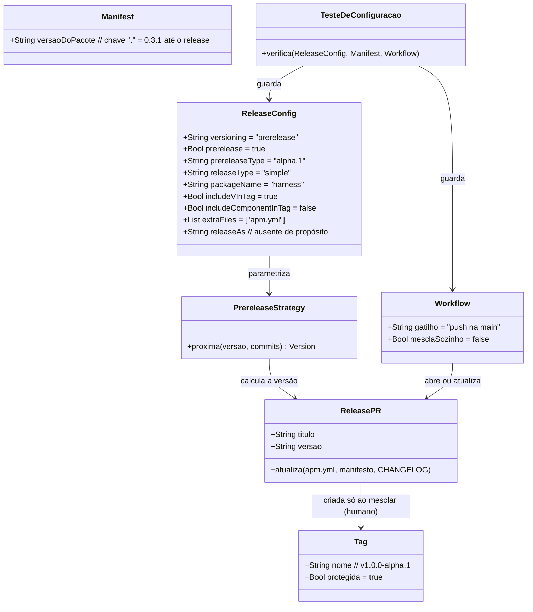

# Pré-lançamento 1.0.0-alpha.1 no release-please

## Requirements

Configurar o release-please do pacote APM para que o MVP da Onda 1 seja publicado como o pré-lançamento `1.0.0-alpha.1` (tag `v1.0.0-alpha.1`, GitHub Release de pré-lançamento), os pré-lançamentos seguintes numerem sozinhos e a versão final `1.0.0` dependa só de mudar uma chave de configuração, mantendo a publicação como ato humano e a configuração guardada por teste e explicada no README.

## Entities

Conservador: só a configuração do pacote `.` muda; workflow, manifesto, nome do pacote e política de tags ficam como estão.

## Approach

1. Configuração:
   - No pacote `.` de `release-please-config.json`, acrescentar `"versioning": "prerelease"`, `"prerelease": true` e `"prerelease-type": "alpha.1"`.
   - Não usar `release-as`.
2. Comportamento esperado da estratégia (lido no código do release-please):
   - Versão estável `0.3.1` com commit incompatível resulta em `1.0.0-alpha.1`, porque o tipo vira o primeiro sufixo.
   - `1.0.0-alpha.N` com qualquer tipo de commit resulta em `1.0.0-alpha.N+1`.
   - Com `prerelease` falso, o sufixo é descartado e a próxima é `1.0.0`.
3. Prova:
   - Teste do repositório para o que depende só de arquivos.
   - Cálculo com a biblioteca `release-please` (piso `17.6.0` e a `17.x` mais recente) numa pasta temporária, para o que depende do comportamento.
4. Documentação:
   - Seção de releases do README com o pré-lançamento, a última versão estável, a saída da final e a correção da frase do marcador.
5. Fluxo depois do merge:
   - O bot atualiza o PR #12; conferir título, `apm.yml`, manifesto e CHANGELOG; o Elói mescla; a tag nasce.
   - O fechamento da Onda 1 (README com o consumo da tag, CHANGELOG, roteiro, retrospectiva) vem depois.

## Structure

### Inheritance Relationships
1. Nenhuma. Não há código novo além do teste e de um script de verificação descartável.

### Dependencies
1. A ação `googleapis/release-please-action` v5.0.0 lê `release-please-config.json` e `.release-please-manifest.json`.
2. A ação usa o pacote `release-please` `^17.6.0`, cuja estratégia `prerelease` interpreta `versioning`, `prerelease` e `prerelease-type`.
3. O teste de configuração depende de `release-please-config.json`, `.release-please-manifest.json` e `.github/workflows/release-please.yml`.
4. O fechamento da Onda 1 depende de a tag `v1.0.0-alpha.1` existir.

### Layered Architecture
1. Configuração de release: `release-please-config.json` e o manifesto.
2. Automação: workflow `release-please.yml` (abre ou atualiza o PR).
3. Decisão humana: mesclar o PR de release.
4. Guarda: `tests/release/`.
5. Documentação: README e CHANGELOG.

## Operations

### Create Tests - tests/release/test_release_config.py
1. Responsibility: guardar a configuração de release.
2. Cases (todos com `unittest`, lendo os arquivos do repositório):
   - Pacote `.` tem `versioning` igual a `prerelease`, `prerelease` verdadeiro e `prerelease-type` igual a `alpha.1`.
   - Não existe a chave `release-as` no pacote `.`.
   - `include-v-in-tag` verdadeiro e `include-component-in-tag` falso.
   - `extra-files` contém `apm.yml`; o manifesto tem a chave `.`.
   - O workflow roda a ação do release-please em push na `main` e não contém `auto-merge`, `gh pr merge` nem `--auto`.
   - A versão da linha `version:` do `apm.yml` é igual à do manifesto.
3. Verification: `python3 -m unittest tests.release.test_release_config -v` falha antes da alteração (casos do pré-lançamento) e passa depois.

### Update Config - release-please-config.json
1. Responsibility: ativar o pré-lançamento.
2. Logic: dentro de `packages["."]`, acrescentar `"versioning": "prerelease"`, `"prerelease": true`, `"prerelease-type": "alpha.1"`; manter `release-type`, `package-name`, `include-v-in-tag`, `changelog-path`, `extra-files` e `include-component-in-tag` como estão.
3. Verification: `python3 -m json.tool release-please-config.json` e os testes passam.

### Verify Versions - cálculo com a biblioteca
1. Responsibility: provar o comportamento do tipo `alpha.1`.
2. Logic: numa pasta temporária fora do repositório, instalar `release-please@17.6.0` e a `17.x` mais recente; com a classe `PrereleaseVersioningStrategy` e as opções `{prerelease: true, prereleaseType: "alpha.1"}`, calcular `0.3.1` com commit incompatível, `1.0.0-alpha.1` com `feat`, `1.0.0-alpha.2` com `fix`; e com `{prerelease: false, prereleaseType: "alpha.1"}`, `1.0.0-alpha.3` com `feat`.
3. Output: `1.0.0-alpha.1`, `1.0.0-alpha.2`, `1.0.0-alpha.3` e `1.0.0`; a saída é registrada no CHANGELOG.

### Verify Schema - configuração contra o schema oficial
1. Responsibility: garantir que as chaves existem.
2. Logic: baixar `schemas/config.json` do release-please e conferir as chaves `versioning`, `prerelease` e `prerelease-type` e seus tipos.

### Update Doc - README.md (Releases)
1. Responsibility: explicar o pré-lançamento.
2. Logic:
   - Parágrafo sobre o pré-lançamento `1.0.0-alpha.1`: a `v0.3.1` continua sendo a última estável; o pré-lançamento exige apontar para a tag explícita e aparece como pré-lançamento no GitHub.
   - Como a `1.0.0` sai: depois da prova, `"prerelease": false` na configuração e o PR de release seguinte propõe `1.0.0`.
   - Cuidado: não usar `release-as`; conferir o PR de release antes de mesclar.
   - Corrigir a frase do marcador: o bot atualiza a linha `version:` do `apm.yml` pelo `extra-files`, sem marcador.
   - Não trocar o exemplo de consumo para a tag nova (ela ainda não existe).
3. Verification: reler cobrindo os cenários da spec.

### Update Doc - CLAUDE.md e CHANGELOG.md
1. Responsibility: registrar o cuidado e o resultado.
2. Logic: `CLAUDE.md` ganha o cuidado de release; `CHANGELOG.md` ganha a seção desta change com a saída da verificação, o que fica para depois do merge e a retrospectiva de skills.

## Norms

1. Commits e título do PR em Conventional Commits; esta change usa `ci(release):`.
2. Textos em português; chaves e valores de configuração exatamente como o release-please os define.
3. Só `unittest` e biblioteca padrão nos testes; a verificação com a biblioteca roda fora do repositório e não adiciona dependência.
4. Nenhuma ferramenta é instalada globalmente; a instalação de `release-please` é local à pasta temporária.
5. Cada task só vira `[x]` depois de o comando de verificação passar.

## Safeguards

1. Release Constraints: o PR #12 não deve ser mesclado antes de estar em `1.0.0-alpha.1`; mesclar é ato do Elói; nenhuma etapa automática mescla o PR de release.
2. Version Constraints: a tag publicada na Onda 1 é `v1.0.0-alpha.1`; a `1.0.0` final só depois da prova da calculadora em Go aprovada; nenhuma configuração de versão fixa (`release-as`) fica pendente.
3. Tag Constraints: tags `v*` não se apagam nem se movem; por isso a conferência do PR de release vem antes do merge.
4. Compatibility Constraints: `package-name`, nome da branch do bot, workflow, manifesto e `extra-files` não mudam.
5. Documentation Constraints: o exemplo de consumo do README só passa a citar a tag nova depois de ela existir.
6. Verification Constraints: o que não puder ser provado aqui (o efeito no PR #12 real) fica declarado e conferido depois do merge.
7. Scope Constraints: nada da `1.0.0` final, da calculadora em Go, do roteiro de teste manual nem do fechamento da Onda 1.
