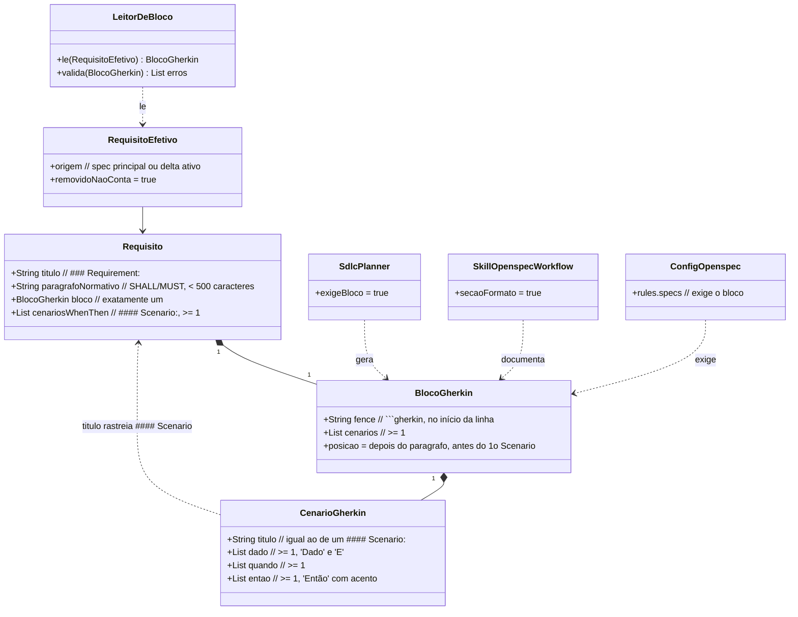

# Cenários Gherkin na spec (F1 da V2.0)

## Requirements

Fazer cada requisito das specs do OpenSpec do pacote APM trazer um bloco ```` ```gherkin ```` com ao menos um cenário `Dado`/`Quando`/`Então` em português, para a intenção ficar testável e legível por máquina, sem trocar o OpenSpec nem o OpenSPDD. Entregar: o formato exato (spec `spec-gherkin-scenarios`), a exigência no `sdlc-planner`, no skill `openspec-workflow` e em `openspec/config.yaml`, o retrofit dos 31 requisitos das 6 specs atuais e um teste estático escrito primeiro. Fora: sensor (F2), skill `acceptance-from-spec` (F3), perfis de SDLC, framework ou executor de Gherkin.

## Entities



Conservador: só adições. Nenhum arquivo de terceiros (`openspec-propose`, hooks, `phase_cli.py`) muda.

## Approach

1. Formato (spec `spec-gherkin-scenarios`):
   - Bloco ```` ```gherkin ```` depois do parágrafo normativo e antes do primeiro `#### Scenario:`; um bloco por requisito.
   - Dentro: `Cenário: <título>` seguido de `Dado`, `Quando`, `Então` (nessa ordem), `E`/`Mas` como continuação, linhas vazias e comentários `#` aceitos.
   - O título repete o de um `#### Scenario:` do requisito; `WHEN`/`THEN` permanecem.
2. Obrigação:
   - Texto do `sdlc-planner`, seção do `openspec-workflow` e `rules.specs` do `config.yaml`.
   - `openspec-propose` não é tocado.
3. Retrofit: deltas `MODIFIED` com texto e cenários idênticos mais o bloco (31 requisitos); os 2 removidos por `versao-final-1-0-0` ficam fora.
4. Prova: teste estático sobre requisitos efetivos (principais + deltas ativos − removidos), escrito antes; contrato dos agentes com a instrução e as cópias idênticas.
5. Implantação: `apm install --target claude,copilot`.

## Structure

### Inheritance Relationships
1. Sem herança de código. O leitor do teste é um módulo de funções simples; o F2 poderá reaproveitá-lo.

### Dependencies
1. `tests/specs/test_gherkin_blocks.py` depende dos arquivos `openspec/specs/*/spec.md` e `openspec/changes/*/specs/*/spec.md` (exceto `archive/`).
2. `tests/agents/test_contract.py` depende de `.apm/agents/`, `.apm/skills/openspec-workflow/` e das cópias implantadas.
3. O planner depende do skill `openspec-propose` (inalterado) e do `config.yaml` para a regra em tempo de geração.
4. Os deltas de `release-versioning` dependem da ordem de arquivamento com `versao-final-1-0-0`.

### Layered Architecture
1. Fonte do formato: spec `spec-gherkin-scenarios`.
2. Guias: planner, `openspec-workflow`, `config.yaml`, `CLAUDE.md`.
3. Dados: 6 specs migradas por deltas.
4. Sensor mínimo: testes em `tests/specs/` e `tests/agents/`.
5. Implantação: `.claude/`, `.github/`, `.agents/`.

## Operations

### Create Tests - tests/specs/test_gherkin_blocks.py (primeiro, vermelho)
1. Responsibility: provar o formato do bloco em todo requisito efetivo.
2. Criar `tests/specs/__init__.py` e o teste com: leitor de requisitos efetivos (parse de `## ADDED/MODIFIED/REMOVED Requirements` dos deltas ativos, troca pelo nome do requisito, exclusão dos removidos); função de validação que devolve a lista de erros.
3. Testes: uma tabela sobre todos os requisitos efetivos (cada um sem erros) e uma tabela de amostras negativas (sem bloco, bloco depois do cenário, sem `Então`, `Entao` sem acento, passos fora de ordem, título sem correspondência) em que cada uma reprova; uma amostra positiva com `E` e dois `Cenário:`.
4. Verificar que o teste falha antes do leitor existir e que as negativas reprovam.
5. Estimativa: ~110 linhas de teste em tabela.

### Update Tests - tests/agents/test_contract.py
1. Responsibility: guardar a instrução e a implantação.
2. Acrescentar: `sdlc-planner.agent.md` e `openspec-workflow/SKILL.md` citam ```` ```gherkin ````, `Dado`, `Quando` e `Então`; as cópias de `.claude/agents`, `.github/agents`, `.claude/skills` e `.agents/skills` são idênticas à fonte.
3. Verificar vermelho com o texto atual. Estimativa: ~30 linhas.

### Update Agent - .apm/agents/sdlc-planner.agent.md
1. Responsibility: o planner passa a gerar o bloco.
2. Acrescentar seção "Cenários Gherkin nas specs" (um bloco por requisito, posição, formato, título igual ao `#### Scenario:`, `WHEN`/`THEN` mantidos, REMOVED sem bloco) e uma menção no passo 2 da ordem de trabalho.
3. Sem termos de stack (o teste de neutralidade segue passando). Estimativa: ~15 linhas.

### Update Skill - .apm/skills/openspec-workflow/SKILL.md
1. Responsibility: documentar o formato exato com um exemplo, ao lado de "Requisitos curtos".
2. Estimativa: ~35 linhas.

### Update Config - openspec/config.yaml
1. Responsibility: `rules.specs` exige o bloco ao gerar specs neste repositório. Feito pela sessão principal ou pelo humano (fora do escopo de escrita do coder).
2. Estimativa: ~8 linhas.

### Update Docs - CLAUDE.md
1. Citar o bloco Gherkin na etapa "Propor" do fluxo SDD. ~3 linhas.

### Deploy - apm install
1. `apm install --target claude,copilot`; conferir `diff` entre fonte e cópias e `claude plugin validate .claude/agents`.
2. Conferir `git diff --stat` sem mudança em `.apm/skills/openspec-propose/`.

### Verify - suíte e validação
1. `python3 -m unittest discover -s tests -t .`, `openspec validate cenarios-gherkin-na-spec --strict`, `openspec validate versao-final-1-0-0 --strict` e `grep -rniE "cowboy|cobol|cobc|calculadora" .apm`.

## Norms

1. Artefatos em português; cabeçalhos estruturais do OpenSpec e SHALL/MUST em inglês.
2. Só `unittest` e biblioteca padrão nos testes.
3. Palavras-chave do Gherkin em português com acento (`Cenário:`, `Então`); fence ```` ```gherkin ```` no início da linha.
4. Um bloco por requisito, mínimo de um cenário; requisitos abaixo de 500 caracteres.
5. Teste primeiro: cada task só vira `[x]` depois de o comando de verificação passar.
6. Commits em Conventional Commits (`feat(agents):`), sem atribuição ao Claude.

## Safeguards

1. Functional Constraints: os `#### Scenario:` com `WHEN`/`THEN` permanecem em todo requisito; `openspec validate --strict` passa.
2. Scope Constraints: nada do sensor F2, do skill `acceptance-from-spec` F3, de perfis de SDLC ou de executor de Gherkin; `openspec-propose` e os hooks não mudam.
3. Content Constraints: o comportamento descrito pelas 31 specs migradas não muda; só o bloco entra, com texto e cenários copiados sem alteração.
4. Cross-Change Constraints: arquivar `versao-final-1-0-0` antes desta change; os 3 blocos acrescentados ao delta dela são a única mudança nele e dependem de confirmação (Q6).
5. Neutrality Constraints: nada de linguagem, ferramenta de build ou projeto de origem nos textos do pacote; `grep` de neutralidade volta vazia.
6. Honesty Constraints: o comportamento do planner com o modelo não é provado por teste estático; declarar "não verificado" até uma proposta real ser gerada e fiscalizada pelo F2.
7. Release Constraints: sem push, tag nem merge do PR de release sem o "ok" do Elói; PR com título `feat(agents):` (sem `!`).
