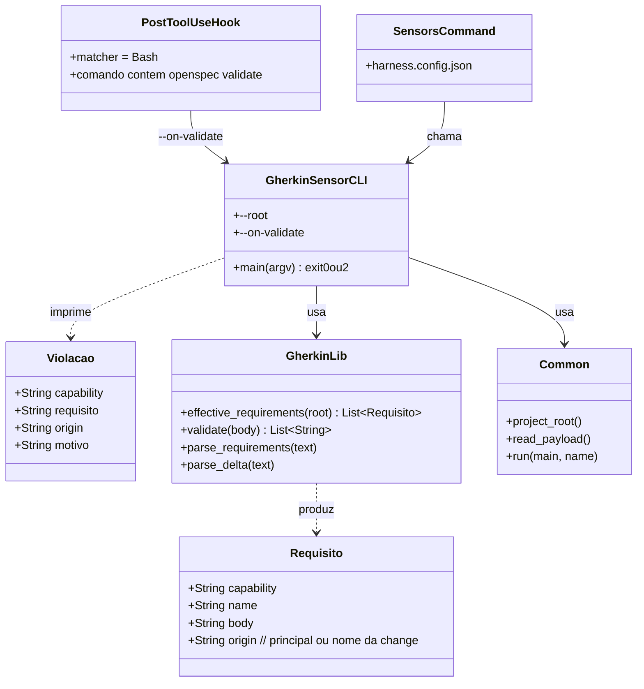

# Sensor de Gherkin (F2 da V2.0)

## Requirements

Entregar um sensor stdlib, ao lado dos hooks do pacote, que lê os requisitos efetivos de um projeto OpenSpec e reprova (código 2) citando capability e requisito quando falta o bloco Gherkin da F1, ou aprova (código 0). Ele roda junto do `openspec validate` por um hook `PostToolUse` entregue pelo APM, e este repositório o inclui no `sensors_command`. A regra de formato passa a viver numa biblioteca única, importada pelo teste da F1. Fora: `acceptance-from-spec` (F3), executor de Gherkin, perfis de SDLC, alteração de agentes ou de hooks existentes.

## Entities

Conservador: só adições; `_common.py` e os demais hooks não mudam (exceto `harness.json`, que ganha um evento).

## Approach

1. Biblioteca `_gherkin.py`: mover do teste da F1 as funções de leitura e validação; trocar as constantes por parâmetro `root`; acrescentar `origin` e `RENAMED`.
2. CLI `gherkin-sensor.py`: resolve a raiz (`--root`, `CLAUDE_PROJECT_DIR`, `.git`); sem `openspec/`, sai 0 com aviso; imprime uma linha por violação e sai 2, ou sai 0 sem saída.
3. Modo `--on-validate`: lê o payload, extrai o comando (Claude: `tool_input.command`; Copilot: `toolArgs`), age só se casar `\bopenspec\s+validate\b`; fail-open.
4. Registro `PostToolUse` (`Bash`) em `harness.json`.
5. Teste da F1 importa de `_gherkin`.
6. Sessão principal: `sensors_command`, README, `CLAUDE.md`.

## Structure

### Inheritance Relationships
1. Sem herança. Funções simples em módulo.

### Dependencies
1. `gherkin-sensor.py` depende de `_gherkin.py` e `_common.py` (mesmo diretório, `sys.path` do script).
2. `tests/specs/test_gherkin_blocks.py` e `tests/hooks/test_gherkin_sensor.py` dependem de `_gherkin` e do script.
3. `harness.json` depende de `${PLUGIN_ROOT}` e do nome do script.
4. `sensors_command` depende do caminho `.apm/hooks/scripts/` neste repo.

### Layered Architecture
1. Regra: `_gherkin.py`.
2. Interface: `gherkin-sensor.py` (CLI e hook).
3. Registro: `harness.json`.
4. Projeto: `harness.config.json`, README, `CLAUDE.md`.
5. Implantação: `apm install`.

## Operations

### Create Tests - tests/hooks/test_gherkin_sensor.py (primeiro, vermelho)
1. Responsibility: provar o contrato do sensor, em tabela, chamando o script como processo (`ProjectCase`).
2. Casos: sem bloco (2, cita capability, nome, motivo); várias violações; conforme (0, stderr vazio); delta `ADDED` sem bloco cita a change; `REMOVED`; `RENAMED`; `archive/`; sem `openspec/`; `--root`; `CLAUDE_PROJECT_DIR`; UTF-8 inválido; `--on-validate` com validate, com outro comando, com payload inválido, com formato Copilot.
3. Verificar vermelho (script inexistente). Estimativa: ~190 linhas.

### Update Tests - tests/hooks/test_package.py e tests/specs/test_gherkin_blocks.py
1. Responsibility: contrato do pacote e reaproveitamento da lógica.
2. `test_package`: eventos incluem `PostToolUse`; matcher `Bash` aponta para `gherkin-sensor.py`; importações permitem `_gherkin`.
3. `test_gherkin_blocks`: importar `validate`, `effective_requirements` etc. de `_gherkin` (via `sys.path` de `HOOK_SCRIPTS`) e remover as definições.
4. Verificar vermelho. Estimativa: ~15 linhas novas, ~110 movidas.

### Create Library - .apm/hooks/scripts/_gherkin.py
1. Responsibility: regra de formato e requisitos efetivos.
2. API: `effective_requirements(root: Path) -> list` de `Requisito`, `validate(body) -> list[str]`, `parse_requirements`, `parse_delta` (com `RENAMED`).
4. Implementado além do previsto: `Requisito` ganhou o campo `error` (arquivo ilegível vira requisito com falha, o sensor cita o arquivo e sai 2 sem traceback); `RENAMED` aceita pares `- FROM:` e `- TO:` com ou sem crases; `tests/specs/test_gherkin_blocks.py` usa o adaptador `efetivos()` para não definir `effective_requirements`, e um teste por AST garante a fonte única.
3. Docstring, só stdlib, sem termos proibidos. Estimativa: ~110 linhas (~25 novas).

### Create Script - .apm/hooks/scripts/gherkin-sensor.py
1. Responsibility: CLI e modo hook.
2. Saída: `gherkin: <capability> / Requirement: <nome> [change <x>]: <motivo>` por violação; códigos 0 e 2; CLI com erro inesperado devolve 2; hook usa `_common.run`.
3. Estimativa: ~90 linhas.

### Update Manifest - .apm/hooks/harness.json
1. Acrescentar `PostToolUse` (`matcher: Bash`, `python3 "${PLUGIN_ROOT}/.apm/hooks/scripts/gherkin-sensor.py" --on-validate`, `timeout: 10`).

### Update Skill - .apm/skills/install-dev-harness/SKILL.md
1. Nota curta sobre o sensor e como compô-lo ao `sensors_command`. ~8 linhas.

### Deploy - apm install
1. `apm install --target claude,copilot`; conferir `PostToolUse` em `.claude/apm-hooks.json` e `.github/hooks/`, `diff` dos scripts e `claude plugin validate .claude/agents`.

### Update Project (sessão principal, fora do coder)
1. `harness.config.json`: `sensors_command` = `python3 -m unittest discover -s tests -t . && python3 .apm/hooks/scripts/gherkin-sensor.py`. Implementado com `-B` nos dois comandos (`python3 -B ...`), para não gerar `__pycache__`.
2. `README.md`: seção "Sensor de Gherkin" e linha na tabela de hooks.
3. `CLAUDE.md`: quality gate. `openspec/config.yaml`: opcional (Q6).

### Verify
1. `python3 -m unittest discover -s tests -t .`; sensor no repo (0) e num projeto temporário sem bloco (2); `openspec validate sensor-de-gherkin --strict`; `grep -rniE "cowboy|cobol|cobc|calculadora" .apm`.

## Norms

1. Artefatos em português; cabeçalhos do OpenSpec e SHALL/MUST em inglês.
2. Só biblioteca padrão; `unittest`.
3. Scripts com docstring, saída só 0 ou 2, sem traceback.
4. Teste primeiro: cada task só vira `[x]` depois de a verificação passar.
5. Conventional Commits (`feat(hooks):`), sem atribuição ao Claude.

## Safeguards

1. Functional Constraints: `openspec validate --strict` passa; o sensor nunca altera arquivos.
2. Scope Constraints: sem F3, sem executor de Gherkin, sem perfis; hooks e agentes existentes intactos.
3. Neutrality Constraints: `grep` de neutralidade vazia; nada de linguagem, pasta ou comando de projeto específico.
4. Robustness Constraints: spec ilegível, payload ou configuração inválidos nunca geram traceback; o hook nunca trava o `validate`.
5. Single Source Constraints: nenhuma cópia da regra de formato fora de `_gherkin.py`.
6. Honesty Constraints: `PostToolUse` no Copilot "não verificado" até teste em host real.
7. Release Constraints: sem push, tag ou merge sem o "ok" do Elói; PR `feat(hooks):`.

<!-- Sync pós-implementação: ressalvas baixas do reviewer abertas (regex `openspec validate` casa por texto; `--root` inválido sai 0 com aviso; faltam testes do ramo Q3 e do fail-open do modo hook). Task 5.5 (disparo ao vivo) não verificada. -->
