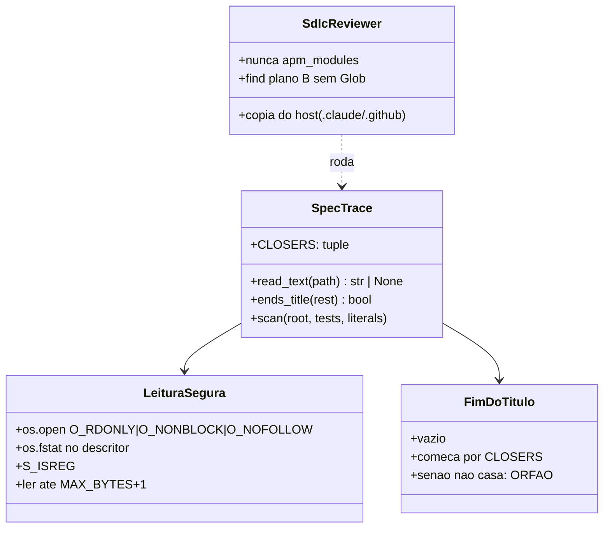

# Endurecer o spec-trace (F6)

## Requirements

Fechar quatro pontos abertos do `spec-trace.py` e do `sdlc-reviewer` depois da F4: (1) `read_text` abre sem janela de corrida (`os.open` com `O_RDONLY|O_NONBLOCK|O_NOFOLLOW` onde existirem, `fstat` no descritor); (2) o resto da linha depois do título só é aceito se vazio ou começar por um fechamento conhecido (`CLOSERS`), senão a linha vira `ORFAO`; (3) subtestes com tab e NBSP antes do fechamento; (4) o reviewer diz que a cópia certa do script é a implantada do host, fora de `apm_modules/`, e que `find` (sem `apm_modules`) é o plano B sem `Glob`. Só adições e correções; stack-agnóstico; reviewer somente leitura. Fora: `Spec:` só como palavra inteira (Q5), modo `--all`, mexer em skill, coder ou planner (F5), ligar ao `sensors_command`.

## Entities

## Approach

1. Testes primeiro (vermelhos pela asserção): corrida na leitura (subprocesso com `os.open` interceptado), sufixos que viram `ORFAO`, texto do reviewer e do README. Fechamentos e tab/NBSP nascem verdes (caracterização, com mutação manual).
2. `spec-trace.py`: `read_text` e `CLOSERS`/`ends_title`; docstring e `--help`.
3. Reviewer: três linhas de prosa em "Cenários x testes".
4. Sessão principal: README, CHANGELOG, `apm install`, cópias.
5. Prova humana: reviewer sem `Glob` e com cópias em `apm_modules/`.

## Structure

### Inheritance Relationships
Nenhuma.

### Dependencies
`spec-trace.py` continua só com biblioteca padrão, `_gherkin` e `_common`. O reviewer não ganha ferramenta.

### Layered Architecture
Fonte em `.apm/`, cópias por host implantadas pelo `apm install`; testes em `tests/hooks` e `tests/agents`.

## Operations

### Update Tests - tests/hooks/test_spec_trace.py (primeiro)
1. Responsibility: teste da corrida (`Spec: spec-trace / Busca em arquivos de teste com exclusões / Arquivo trocado por FIFO depois da listagem`); tabela de fechamentos x espaços (`Spec: spec-trace / Fim do título do marcador / Fechamento conhecido depois do título`); sufixos que não são fechamento (`... / Sufixo que não é fechamento`); comentários `Extra:` nos testes dos extras.
2. Registrar comando, contagem de falhas e o motivo de cada vermelho (asserção). Estimativa: ~85 linhas.

### Update Tests - tests/agents/test_reviewer_scenarios.py
1. Responsibility: `Spec: sdlc-agent-roles / Reviewer confere cada cenário contra um teste / Cópia certa do script` (texto com `apm_modules`, `find` e os dois caminhos de host); `ReadmeTest` com a regra do fim do título. Estimativa: ~15 linhas.

### Update Script - .apm/hooks/scripts/spec-trace.py
1. Responsibility: `read_text` com `os.open`, `fstat`, `finally`; `CLOSERS` e `ends_title` por `startswith`; docstring e `--help`. Estimativa: ~25 linhas.

Implementado além do previsto, após a revisão: `ends_title` passou a exigir **fronteira depois do fechamento** (fim da linha, espaço — tab e NBSP inclusive — ou outro fechamento conhecido); `Caso#2`, `Caso'2`, `Caso"abc`, `Caso)extra`, `Caso*/x`, `Caso-->x` e `Caso//x` viram `ORFAO`, enquanto `") # x`, `*/ -->`, `*/-->` e CRLF seguem válidos (achado médio do reviewer, 7 falhas por asserção no vermelho). A mutação manual `lstrip()` para `lstrip(" ")` fez o teste de tab e NBSP falhar em 28 subtestes e foi revertida. O teste da corrida usa um subprocesso `-I` que troca `os.open` e confere as flags.

### Update Agent - .apm/agents/sdlc-reviewer.agent.md
1. Responsibility: cópia do host, nunca `apm_modules/`, `find` como plano B. Estimativa: ~4 linhas de prosa.

### Update Docs (sessão principal)
1. `README.md` (regra do fim do título, lista, aviso de migração, cópia do host e `find`) e `CHANGELOG.md`.

### Deploy (sessão principal)
1. `apm install --target claude,copilot`; `diff` das cópias; `claude plugin validate .claude/agents`.

### Verify
1. `python3 -B -m unittest discover -s tests -t .`; `openspec validate endurecer-spec-trace --strict`; `python3 -B .apm/hooks/scripts/gherkin-sensor.py` (sai 0); `grep -rniE "cowboy|cobol|cobc|calculadora" .apm` vazia; prova humana 6.4.

## Norms

1. Artefatos em português; cabeçalhos do OpenSpec e SHALL/MUST em inglês.
2. Sem nome de ferramenta de teste no reviewer nem no script.
3. Teste primeiro; `Spec:` só em cenário do bloco; `Extra:` nos extras; relatar o vermelho com comando e contagem e dizer quais testes são verdes de nascença.
4. Conventional Commits (`fix(agents):` ou `fix(hooks):`), sem atribuição ao Claude.
5. `unittest`, em tabela (`subTest`); só biblioteca padrão nos scripts.

## Safeguards

1. Functional Constraints: o script sai só com 0 ou 2; link, FIFO, dispositivo, binário, grande e `.md` seguem ignorados; casamento por prefixo mais longo preservado.
2. Read-only Constraints: reviewer com `Read, Grep, Glob, Bash`; script sem escrita, sem `git` e sem `__pycache__`.
3. Scope Constraints: sem `Spec:` só como palavra, sem `--all`, sem hook ou `sensors_command`, sem mexer em skill, coder ou planner.
4. Migration Constraints: marcador com sufixo fora de `CLOSERS` sai `ORFAO` e o cenário `SEM_TESTE`; avisar no README e no CHANGELOG.
5. Neutrality Constraints: `grep` de neutralidade vazia; `STACK_TERMS` não casa no reviewer.
6. Release Constraints: sem push, tag ou merge sem o "ok" do Elói.

<!-- Sync pós-implementação. A task 6.4 (reviewer sem Glob, com cópias em apm_modules/) não foi feita; a lista CLOSERS não foi confirmada contra projetos externos; a correção da fronteira não passou por nova revisão. Fora do escopo (Q5): line.find("Spec:") casa também dentro de palavra (InSpec:). -->
